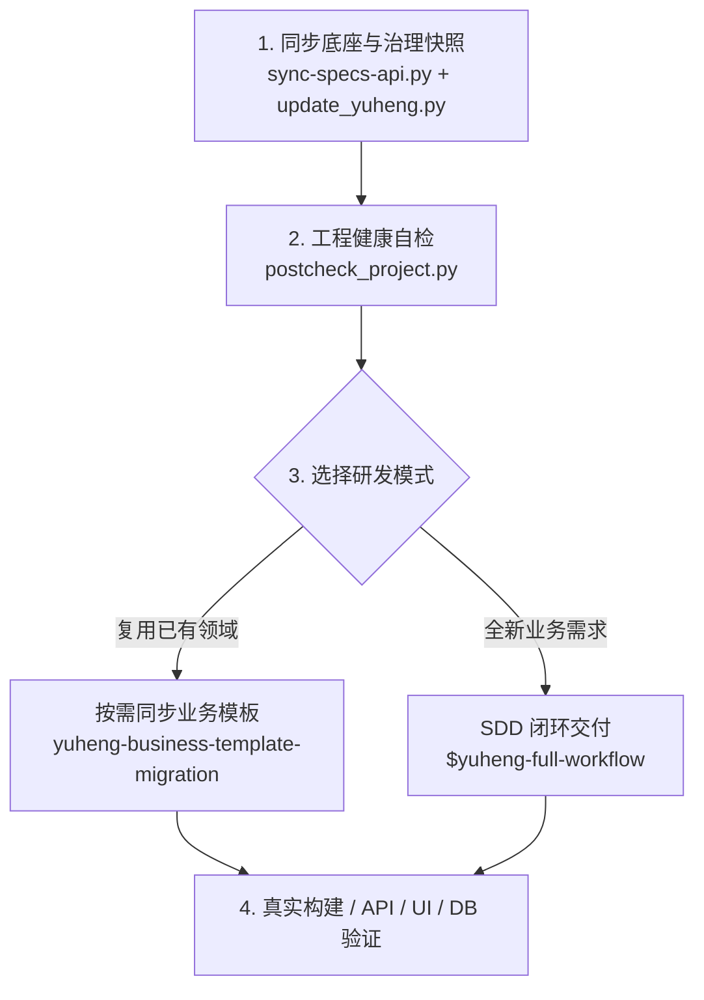

<div align="center">

# 🚀 Yuheng Demo

**Yuheng（聿珩）AI 原生消费端标准脚手架 · SDD（Spec-Driven Development）交付演练沙箱**

[](https://openjdk.org/)
[](https://github.com/huhua1990/yuheng-core)
[](https://vuejs.org/)
[](#设计理念纯净消费端底座)
[](#ai-原生-sdd-日常研发工作流)

[简体中文](./README.md) · [消费端 AI 入口 (AGENTS.md)](./AGENTS.md) · [平台内核 (yuheng-core)](https://github.com/huhua1990/yuheng-core) · [业务模板库 (yuheng-business-templates)](https://github.com/huhua1990/yuheng-business-templates)

</div>

---

## 💡 设计理念：纯净消费端底座

`yuheng-demo` 是基于 [`yuheng-core`](https://github.com/huhua1990/yuheng-core) 构建的**标准消费端 Bootstrap 工程**，严格遵循以下工程边界：

1. **版本化依赖，不耦合源码**：
   * 后端通过 Maven 依赖 `com.yuheng:yuheng-server:${yuheng.version}` 消费平台能力（平台包名 `com.yuheng.platform`，业务自有包名 `com.yuheng.demo`）。
   * 前端通过 `yuheng-ui` npm 包消费平台运行时、布局与组件，严禁直接引用 `yuheng-core` 源码目录。
2. **零预设业务模板膨胀**：
   * 本工程保持为**纯净底座脚手架**，默认不预置 ERP、CRM、会员、商城等重型业务模板代码。
   * 实际项目中需要哪些业务模块，由开发者或 AI 代理按需从 [`yuheng-business-templates`](https://github.com/huhua1990/yuheng-business-templates) 同步、重写包名并接入迁移。
3. **开箱即用的 AI SDD 上下文**：
   * 工程内维护了同步自 `yuheng-core` 的规则快照（`yuheng-rules/`）、技能快照（`yuheng-skills/`）与平台知识库（`ai-knowledge-core/`），以及消费端差异叠加层（`consumer-overlay/`），让 AI 代理在不读取 `yuheng-core` 源码的情况下也能精准开展 SDD 开发。

---

## 🏗️ 工程架构与目录地图

```text
yuheng-demo/
├── yuheng-demo-server/                   # 后端工程（Maven 多模块）
│   ├── yuheng-demo-business/             # 业务扩展模块（com.yuheng.demo.*，按需接入业务源码与迁移）
│   └── yuheng-demo-server-bootstrap/     # 启动与运行配置（Liquibase 主入口、application-local.yaml）
├── yuheng-demo-ui/                       # 前端工程（Vue 3 + TypeScript + Vite + 平台导入边界检查）
├── yuheng-rules/                         # 🛡️ 从 core 同步的 AI 治理规则快照（只读托管）
├── yuheng-skills/                        # 🤖 从 core 同步的 SDD 技能快照（只读托管）
├── ai-knowledge-core/                    # 📚 从 core 同步的平台知识库快照（server / ui / data）
├── consumer-overlay/                     # 🔧 消费端专属覆盖与升级技能（如 yuheng-upgrade）
├── sync/skills/sync-specs/               # 🔄 治理快照同步与健康检查脚本
├── docs/                                 # 📝 SDD 交付物（specs/ · plans/ · verification/）
├── scripts/                              # 🚀 构建、启停与回归测试脚本（build.sh / start.sh / stop.sh）
├── yuheng-manifest.yaml                  # 消费端版本清单（code / governance / knowledge 版本锁）
└── AGENTS.md / CLAUDE.md                 # AI 编码代理统一入口
```

> **数据库基线说明**：MySQL 空库通过启动模块的 `src/main/resources/db/changelog/db.changelog-master.yaml` 按顺序加载 `yuheng-core` 基础迁移与 `yuheng-demo` 业务 `db/changelog/business/`。部署前请务必修改历史测试账号密码及外部密钥；已有数据库不可直接运行空库基线。

---

## 🚀 快速开始（构建、启动与停止）

### 环境准备

* **Java 17+**、**Maven 3.9+**
* **Node.js 20.19+ 或 22.12+**、**pnpm 9.x**
* **Python 3.9+**、**rsync**
* **MySQL 8.0+**、**Redis**（默认 `local` profile 连接配置见 `yuheng-demo-server-bootstrap/src/main/resources/application-local.yaml`，支持 Spring 环境变量覆盖）

> 依赖前提：本地 Maven 仓库需已安装对应版本的 `com.yuheng:yuheng-server`（可在 `../yuheng-core` 运行 `./yuheng-core.sh install`），npm 仓库或本地缓存需有对应版本的 `yuheng-ui`。

### 1. 一键构建与本地启停

```bash
# 1. 构建前后端（产物为 yuheng-demo.jar 与 yuheng-demo-ui/dist/）
./scripts/build.sh

# 若 yuheng-ui 尚未发布到 npm 仓库，可直接传入本地打包的 .tgz 产物：
# YUHENG_UI_PACKAGE=/absolute/path/yuheng-ui-0.1.0-SNAPSHOT.tgz ./scripts/build.sh

# 2. 启动前后端开发/联调服务
./scripts/start.sh

# 3. 停止由脚本启动的服务
./scripts/stop.sh
```

* **默认前端地址**：`http://127.0.0.1:5173`（自动将 `/admin-api` 代理到后端）
* **默认后端端口**：`48080`（可通过环境变量 `UI_PORT`、`UI_HOST`、`BACKEND_PORT` 调整）
* **生命周期日志与 PID**：保存在 `logs/lifecycle/`

### 2. 单 JAR 独立运行模式

`yuheng-demo.jar` 在构建时已内嵌前端静态资源，可直接单包启动并通过 `http://127.0.0.1:48080/` 访问：

```bash
java -jar yuheng-demo-server/yuheng-demo-server-bootstrap/target/yuheng-demo.jar
```

> 注意：请勿在进程运行期间原地覆盖重建 `yuheng-demo.jar`，重建前应先执行 `./scripts/stop.sh`。

---

## 🤖 AI 原生 SDD 日常研发工作流

在 `yuheng-demo` 中，无论是同步底座、引入业务模板还是开发全新需求，均有标准化的 AI Skill 与确定性脚本支撑：



### 常用维护与交付命令

| 场景 | 执行命令 / AI 技能入口 |
| :--- | :--- |
| **同步 Core 规则/技能/知识库快照** | `python3 sync/skills/sync-specs/scripts/sync-specs-api.py --source ../yuheng-core --target . --apply --project-id yuheng-demo --json` |
| **消费端工程健康检查 (Postcheck)** | `python3 sync/skills/sync-specs/scripts/postcheck_project.py --project-root . --project-id yuheng-demo --json` |
| **升级 `yuheng-server` / `yuheng-ui` 版本** | `python3 consumer-overlay/yuheng-upgrade/scripts/update_yuheng.py --core ../yuheng-core --target . --apply --json`（详见 `consumer-overlay/yuheng-upgrade/SKILL.md`） |
| **按需迁移业务模板（如 pay / pms / erp）** | 触发 `yuheng-business-template-migration` Skill，配合 [`yuheng-business-templates`](https://github.com/huhua1990/yuheng-business-templates) 的 `tools/template_update.py` |
| **端到端开发新业务功能 (SDD)** | `$yuheng-full-workflow`（或分阶段调用 `$yuheng-requirement-to-spec` → `$yuheng-spec-to-plan` → `$yuheng-delivery-execution`） |
| **前端边界与严格类型检查** | `cd yuheng-demo-ui && pnpm test && pnpm run typecheck && pnpm run build && pnpm run lint:platform-imports` |

---

## 📄 相关仓库与许可证

* **平台内核**：[`huhua1990/yuheng-core`](https://github.com/huhua1990/yuheng-core)
* **业务模板库**：[`huhua1990/yuheng-business-templates`](https://github.com/huhua1990/yuheng-business-templates)
* **重构来源致敬**：[`ruoyi-vue-pro`](https://gitee.com/zhijiantianya/ruoyi-vue-pro)
