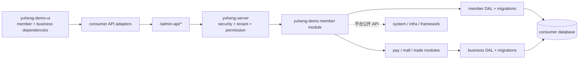

# Yuheng member 模块完整迁移设计

**日期：** 2026-10-26  
**状态：** 根据范围修订，等待规格审阅  
**目标工程：** `/Users/huhua/study/ai/yuheng/yuheng-demo`

## 1. 背景与修订原则

`yuheng-core` 已提供可版本化的 `yuheng-server`、system、infra 和
`yuheng-ui` 平台能力。消费端需要承载来自 `ruoyi-vue-pro` 的业务模块。

本次修订明确：迁移单元是一个完整业务模块，而不是从模块中挑选几个页面。
`member` 在 `ruoyi-vue-pro` 已经是完整模块，迁移到 Yuheng 后也必须保留它的
全部后端能力、全部前端页面、数据库对象、菜单权限、接口、消息和测试。

实施可以分阶段安排依赖顺序，但阶段化不能通过删减功能来降低范围。某个模块
只有在其完整文件清单、接口清单、数据清单和依赖闭包都完成后，才算迁移完成。

## 2. 迁移目标

将 `ruoyi-vue-pro` 的 `yudao-module-member` 完整迁移为
`yuheng-demo` 的独立业务模块，并保持现有业务行为和接口兼容性。

完整迁移包括：

- 后端全部 Java 源码、资源、测试和模块构建配置；
- Admin 和 App 全部 Controller、VO、Service、API、DTO、消息和转换器；
- 用户、地址、配置、标签、分组、等级、经验、积分、签到和认证等完整业务；
- 前端全部 member API、页面、弹窗、选择器、详情卡片和路由；
- member 使用的全部表、索引、序列、初始化数据、菜单、权限和字典；
- member 对 pay、mall、trade 等业务模块的依赖闭包；
- 与平台 system、infra、security、tenant、MQ、Redis 等能力的版本化集成；
- 迁移后的单元测试、集成测试、契约测试和行为对照记录。

## 3. 模块归属与边界

### 3.1 平台与业务的分界

| 层次 | 归属 | 职责 |
| --- | --- | --- |
| 平台运行时 | `yuheng-core` | framework、system、infra、鉴权、租户、权限、字典、文件、消息和公共 Web 能力 |
| 业务后端 | `yuheng-demo` 子模块 | member 以及其业务依赖模块的完整代码和数据 |
| 消费端装配 | `yuheng-demo` 根工程 | Spring Boot 启动入口、业务模块依赖、环境配置和数据库入口 |
| 平台前端 | `yuheng-ui` | 布局、请求客户端、登录、权限、字典、通用组件、system/infra 页面 |
| 业务前端 | `yuheng-demo-ui` | member 以及依赖业务模块的完整 API、页面、组件和路由 |

member 不放入 `yuheng-core`，也不从 `ruoyi-vue-pro` 源码路径运行时引用。
它作为消费端业务 artifact 发布，由消费端显式装配。

为降低迁移风险，首轮保留现有
`cn.iocoder.yudao.module.member` 包命名，同时把 Maven artifact、源码目录和
版本边界迁入 Yuheng。包名统一属于后续独立重构，不影响本次完整迁移。

### 3.2 依赖闭包原则

member 后端当前直接依赖 core 的 system 和 infra，以及租户、安全、MyBatis、
Redis、MQ、Excel 和 IP 等 starter。这些属于平台依赖，由 `yuheng-core`
版本提供。

member 前端的完整详情和操作页面还引用 pay、mall/trade/promotion 的 API 和
组件。它们属于业务依赖，不能用空页面或临时桩替代。实施时建立业务依赖图：

1. 先识别 member 的后端 artifact、前端 API、组件和菜单依赖；
2. 依赖属于 core 的，改为使用 core 公开 API；
3. 依赖属于业务模块的，把对应业务模块完整迁入 `yuheng-demo`，再装配 member；
4. 依赖模块也按同一“完整模块”标准验收；
5. 任何暂时无法迁移的依赖都记录为阻塞项，不能把受影响页面标记为完成。

### 3.3 运行时数据流



## 4. 完整迁移清单

### 4.1 后端清单

来源：
`/Users/huhua/study/ai/yuheng/ruoyi-vue-pro/yudao-module-member`

必须完整迁移以下目录和内容：

- `src/main/java/.../member/api`
- `src/main/java/.../member/controller/admin`
- `src/main/java/.../member/controller/app`
- `src/main/java/.../member/convert`
- `src/main/java/.../member/dal`
- `src/main/java/.../member/enums`
- `src/main/java/.../member/framework`
- `src/main/java/.../member/mq`
- `src/main/java/.../member/service`
- `src/test/java`
- `src/test/resources`
- 模块 `pom.xml` 及其测试配置

当前基线包含约 189 个后端源码文件。迁移时生成源文件清单和目标文件清单，
每个源文件必须有目标对应物；如果因包名、artifact 或 API 变更而改写，清单
中记录变更原因和验证结果。

后端不得只迁移 Admin 用户页面对应的 Controller。App 认证、用户资料、地址、
社交登录、等级、积分、签到以及对外 API 都属于 member 完整模块的一部分。

### 4.2 前端清单

来源：

- `/Users/huhua/study/ai/yuheng/yudao-ui-admin-vue3/src/api/member`
- `/Users/huhua/study/ai/yuheng/yudao-ui-admin-vue3/src/views/member`

必须完整迁移：

- `api/member/address`
- `api/member/config`
- `api/member/experience-record`
- `api/member/group`
- `api/member/level`
- `api/member/point`
- `api/member/signin`
- `api/member/tag`
- `api/member/user`
- `views/member/config`
- `views/member/group`
- `views/member/level`
- `views/member/point`
- `views/member/signin`
- `views/member/tag`
- `views/member/user`

用户详情中的账户、余额、优惠券、订单、售后、收藏和佣金页面也保留。它们
依赖的 pay、mall/trade/promotion API 和组件必须纳入业务依赖闭包，或者先完成
对应完整模块迁移。

### 4.3 数据、菜单和治理清单

- 所有 `member_*` 表、字段、索引、唯一约束、序列和逻辑删除配置；
- MySQL、PostgreSQL、DM 等目标数据库对应的 DDL/迁移脚本；
- member 菜单树、路由、组件名和权限码；
- `common_status`、积分/经验业务类型等所需字典数据；
- 初始配置、默认等级、默认签到配置等种子数据；
- 模块版本、依赖版本、来源 commit 和验证记录；
- AI 治理资产中的模块边界、接口清单和迁移规则。

## 5. 后端工程结构

`yuheng-demo` 转为能够承载业务子模块的 Maven reactor。根工程继续保留
Spring Boot 启动职责，并显式依赖业务 artifact：

```text
yuheng-demo/
├── pom.xml
├── yuheng-module-member/
│   ├── pom.xml
│   └── src/
├── yuheng-module-pay/                 # member 依赖闭包按实际清单加入
├── yuheng-module-mall/
├── yuheng-module-trade/
└── src/main/java/com/yuheng/demo/...
```

member 模块依赖：

- `com.yuheng:yuheng-server:${yuheng.version}`；
- core 提供的公共 starter；
- 业务依赖闭包中确实被 member 使用的其他 Yuheng 业务 artifact。

根工程不能通过复制 core 源码、依赖 ruoyi 本地 module 或直接读取 ruoyi
源目录来绕过 artifact 边界。`yuheng-server` 仍然是平台稳定入口，业务模块
由消费端负责组合。

## 6. 前端工程结构

消费端继续使用 `yuheng-ui` 根入口：

```text
yuheng-demo-ui/src/
├── api/
│   ├── member/
│   ├── pay/
│   ├── mall/
│   └── trade/
├── views/
│   ├── member/
│   ├── pay/
│   ├── mall/
│   └── trade/
├── router/
│   ├── business.ts
│   └── business-modules/
└── modules/
    └── business-manifest.ts
```

member 页面可以继续使用基线目录布局，但必须满足以下边界：

- 平台能力只从 `yuheng-ui` 公开入口导入；
- 业务 API 和业务组件从消费端业务目录导入；
- 不从 `yuheng-core/yuheng-ui/src` 反向导入；
- 路由、菜单权限和组件名保持基线兼容；
- member 详情页的跨模块组件由业务依赖模块提供，不复制到 member 内部；
- 完整页面都参与 typecheck、构建、路由和权限验证。

## 7. API、权限和租户兼容性

### 7.1 API 兼容

完整迁移默认保持 ruoyi 基线的：

- HTTP 方法和路径；
- 请求参数、分页结构和响应字段；
- `CommonResult`、`PageResult` 和错误码语义；
- Admin/App Controller 的认证方式；
- API DTO、消息和模块间调用接口。

如果 Yuheng 平台公共契约导致必须调整，先建立兼容适配层，并在 API 差异表中
记录旧契约、新契约、迁移原因、兼容期限和测试证据。不能直接删除基线接口。

### 7.2 权限

完整迁移所有 member 菜单和权限码，包括但不限于：

- `member:user:*`
- `member:tag:*`
- `member:group:*`
- `member:level:*`
- `member:level-record:*`
- `member:experience-record:*`
- `point:record:*`
- `point:sign-in-config:*`
- `point:sign-in-record:*`
- 配置和地址相关权限

前端路由过滤只负责体验；后端 `@PreAuthorize` 和 core 权限服务负责最终约束。

### 7.3 租户

- 所有 member 和业务依赖表保留 `tenant_id`、逻辑删除和审计字段；
- 查询、详情、更新、统计和消息消费都使用当前租户上下文；
- 不能通过跨租户 ID 读取或修改记录；
- 同 ID 跨租户验证纳入每个模块的集成测试；
- 业务模块不自行解析租户请求头，统一使用 core 租户上下文。

## 8. 完整迁移实施顺序

实施按依赖顺序拆分，但每个阶段都以完整模块为交付单位：

1. **基线盘点**：生成 member 后端、前端、SQL、菜单、权限、字典、消息和
   依赖文件清单；同时扫描 pay、mall、trade 交叉引用。
2. **平台契约确认**：确认 member 使用的 system、infra、security、tenant、
   MQ、Redis、Excel、IP API 已在 `yuheng-core` 发布并可消费。
3. **业务依赖迁移**：对 member 前端和后端实际引用的 pay、mall、trade 等
   模块按完整模块标准迁入并通过各自验证。
4. **member 后端完整迁移**：一次性迁移全部源码、资源、测试、DDL、菜单和
   权限，不删减 App/Admin 或积分/签到等子域。
5. **member 前端完整迁移**：迁移全部 API、页面、详情卡片、组件、路由和
   业务依赖导入，确保完整页面可构建。
6. **行为对照验证**：对照 ruoyi 基线执行 API、权限、租户、数据库和页面
   验收，记录所有差异。
7. **消费端发布集成**：更新业务模块 manifest、版本和来源 commit，执行
   core/consumer CI 门禁和安装包验证。

如果业务依赖尚未迁移，member 后端可以先在分支上完成编译，但 member
完整迁移状态必须保持“未完成”，直到依赖闭包和全部前端页面可运行。

## 9. 测试与完成定义

### 9.1 测试

后端：

- 原 member 单元测试全部迁移并通过；
- Admin/App Controller 契约测试覆盖成功、参数校验、认证、权限和错误；
- Service、Mapper、消息和任务测试覆盖核心业务；
- 多租户隔离、逻辑删除、唯一约束和并发更新测试；
- Maven reactor package、安装和消费端启动装配验证。

前端：

- member 全部 API 类型和请求路径检查；
- 全部页面 typecheck、构建和测试；
- 路由、菜单、权限按钮和详情跨模块组件验证；
- 不得存在未解析的 pay/mall/trade 导入；
- 平台边界检查通过，业务页面不得从平台源码目录导入。

对照验证：

- 源文件清单与目标文件清单逐项闭合；
- Controller、API、权限、菜单、字典和数据库对象逐项闭合；
- 页面和组件清单逐项闭合；
- 任何差异都有记录、原因和测试证据。

### 9.2 完成定义

member 只有同时满足以下条件才标记为完成：

- 后端全部源码、资源、测试和构建配置已进入消费端独立模块；
- Admin/App/API/消息/数据访问等功能没有按页面或子域删减；
- 前端全部 member 页面和 API 已迁移并可构建；
- pay、mall、trade 等依赖闭包已完整迁移或已作为独立已发布业务 artifact
  接入；
- 所有表、菜单、权限、字典和种子数据已迁移；
- API、租户、权限和行为对照验证通过；
- `yuheng-demo` 不引用 ruoyi 源码路径；
- 原始 `yudao-ui-admin-vue3` 未被修改；
- manifest、规格和验证记录可追溯来源版本与迁移结果。

## 10. 风险与决策

### 10.1 迁移范围会扩大

完整迁移必然比最小试点涉及更多模块和页面。解决方式是按依赖顺序安排多个
完整模块交付，不通过删页面、删接口或加空壳组件来缩小范围。

### 10.2 member 前端存在跨业务依赖

用户详情页的余额、订单、优惠券、售后、收藏和佣金功能依赖 pay、mall、trade。
这些依赖纳入闭包清单，优先迁移其被 member 实际使用的完整模块。

### 10.3 core 与业务模块的边界

登录、租户、权限、字典、文件和基础设施继续由 core 版本管理；会员、支付、
商城、交易等业务由消费端 artifact 管理。两者通过 Maven/NPM 版本和 manifest
组合，不把业务源码塞入 core。

### 10.4 包名兼容

首轮保留 `cn.iocoder.yudao.module.member` 包名，减少完整迁移中的无关改动。
包名重命名另立任务，不能作为删减模块功能的理由。
