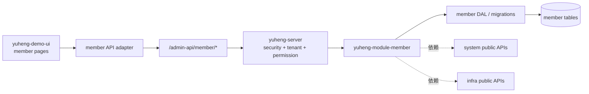

# Yuheng member 用户管理试点设计

**日期：** 2026-10-26  
**状态：** 设计已确认，等待规格审阅  
**目标工程：** `/Users/huhua/study/ai/yuheng/yuheng-demo`

## 1. 背景与目标

`yuheng-core` 已经提供可版本化的 `yuheng-server`、system、infra 和
`yuheng-ui` 平台能力。下一阶段在消费端验证独立业务模块的迁移方式，首个试点
选择后台会员用户管理闭环。

本试点要让具有相应权限的后台管理员完成以下操作：

1. 登录消费端并进入 member 用户菜单；
2. 按昵称、手机号、邮箱、注册时间、登录时间、标签、等级和分组分页查询用户；
3. 查看用户详情；
4. 修改用户基础资料；
5. 修改标签、分组和等级关联；
6. 在权限不足或跨租户访问时得到统一、可理解的拒绝结果。

本设计只覆盖首批闭环，不把未准备好的支付、商城和交易模块隐式带入消费端。

## 2. 范围

### 2.1 首批范围

后端业务模块包含：

- 会员用户分页、详情和编辑；
- 用户等级调整；
- 标签、分组、等级的启用项选择器；
- 与上述功能直接相关的实体、Mapper、Service、Controller、转换器和测试；
- 会员核心表的数据库迁移与租户字段验证。

前端业务模块包含：

- 用户列表页；
- 用户详情页；
- 用户编辑弹窗或页面；
- 标签、分组、等级选择器；
- 等级调整入口；
- member API 类型和请求适配；
- member 业务路由与权限元数据。

### 2.2 明确不在首批范围

以下内容保留在后续业务阶段：

- 积分修改、积分记录页面；
- 签到配置和签到记录；
- 余额、钱包和支付流水；
- 优惠券发送；
- 订单、售后、收藏和佣金；
- member 独立的标签、分组、等级 CRUD 管理页面；
- 会员 App 端认证、地址写入和社交登录。

用户分页响应中已有的积分、总积分和经验字段可以作为只读兼容字段返回，
但不作为首批可操作功能和验收条件。

## 3. 架构与边界

### 3.1 归属关系

| 层次 | 归属 | 职责 |
| --- | --- | --- |
| 平台运行时 | `yuheng-core` | `yuheng-server`、登录鉴权、租户上下文、权限菜单、字典、文件和地区等公共能力 |
| 业务后端 | `yuheng-demo/yuheng-module-member` | member 的业务代码、数据库访问、业务校验和 API |
| 消费端装配 | `yuheng-demo` 根工程 | 引入 member artifact，提供 Spring Boot 启动入口和运行配置 |
| 平台前端 | `yuheng-ui` | 布局、请求客户端、登录、权限、字典、通用组件和 system/infra 页面 |
| 业务前端 | `yuheng-demo-ui/src/modules/member` | member 页面、API、类型、业务路由和页面状态 |

member 不放入 `yuheng-core`，也不从 `ruoyi-vue-pro` 源码路径运行时引用。
后端模块依赖版本化的 `com.yuheng:yuheng-server`，前端依赖发布的
`yuheng-ui` 根入口。

为降低首批迁移风险，后端暂时保留现有
`cn.iocoder.yudao.module.member` 包命名。artifact、Maven 模块和仓库边界
先完成拆分；包名统一另作为独立迁移任务，避免把命名迁移和业务迁移混在一起。

### 3.2 运行时数据流



前端只调用后端公开 HTTP 契约。member 后端通过 system 和 infra 的公开能力
完成当前登录人、字典、文件/地区等平台需求，不直接访问这些模块的内部实现。

### 3.3 建议目录

后端：

```text
yuheng-demo/
├── pom.xml
└── yuheng-module-member/
    ├── pom.xml
    └── src/
        ├── main/java/cn/iocoder/yudao/module/member/
        │   ├── controller/admin/user/
        │   ├── controller/admin/tag/
        │   ├── controller/admin/group/
        │   ├── controller/admin/level/
        │   ├── convert/
        │   ├── dal/
        │   └── service/
        └── test/
```

前端：

```text
yuheng-demo-ui/src/
├── api/member/
├── modules/member/
│   ├── routes.ts
│   ├── permissions.ts
│   └── components/
└── views/member/
    └── user/
```

页面可以继续按 `src/views/member` 组织，但所有 member 入口必须由消费端
`businessRoutes` 注册；平台包不反向依赖消费端页面。

## 4. 后端 API 契约

首批沿用现有 `/member/*` 路径，消费端的请求基地址由 `yuheng-ui` 统一配置为
`/admin-api`。

| 方法 | 路径 | 权限 | 用途 |
| --- | --- | --- | --- |
| `GET` | `/member/user/page` | `member:user:query` | 用户分页 |
| `GET` | `/member/user/get?id={id}` | `member:user:query` | 用户详情 |
| `PUT` | `/member/user/update` | `member:user:update` | 修改用户资料及关联 |
| `PUT` | `/member/user/update-level` | `member:user:update-level` | 修改用户等级 |
| `GET` | `/member/tag/list-all-simple` | `member:tag:query` | 启用标签选择器 |
| `GET` | `/member/group/list-all-simple` | `member:group:query` | 启用分组选择器 |
| `GET` | `/member/level/list-all-simple` | `member:level:query` | 启用等级选择器 |

用户分页请求保留以下筛选字段：

- `pageNo`、`pageSize`；
- `nickname`、`mobile`、`email`；
- `createTime`、`loginDate`；
- `tagIds`、`levelId`、`groupId`。

用户更新请求保留现有字段校验：手机号、状态和昵称必填；邮箱格式、
头像 URL、昵称和备注长度按后端校验规则执行。等级更新要求用户 ID、
调整原因，并允许清空等级。

三个选择器接口归入 admin API 并增加对应 query 权限。这样接口安全不依赖
前端按钮隐藏，且与用户页面的权限模型一致。

## 5. 权限、租户和错误处理

### 5.1 权限

- 路由元数据携带上述权限码，由 `yuheng-ui` 在菜单加载时过滤；
- 页面上的编辑和等级调整按钮按同样权限码控制显示；
- 后端 Controller 使用 `@PreAuthorize` 做最终校验；
- 未授权请求返回 core 统一的权限错误响应，前端由平台请求层负责提示。

### 5.2 租户隔离

- member 表保留 `tenant_id`、逻辑删除和审计字段；
- 所有分页、详情和更新操作使用当前租户上下文；
- member 不自行解析租户请求头，租户上下文由 `yuheng-core` 建立；
- 其他租户的同 ID 记录不可读、不可改，外部表现为统一的不存在或无权访问；
- 服务层测试必须覆盖同 ID 跨租户读取和更新场景。

### 5.3 错误处理

- 成功和失败响应使用 core 的 `CommonResult` 及错误码体系；
- 参数不合法、权限不足、租户越权、记录不存在分别保持可区分的错误语义；
- 前端不复制一套 axios 或错误码处理，只使用 `yuheng-ui` 导出的请求客户端；
- 页面提交失败时保留表单输入，列表刷新只在服务端更新成功后执行。

## 6. 迁移策略

迁移按可回滚的小步执行：

1. **模块骨架**：把 `yudao-module-member` 的业务代码复制到
   `yuheng-demo/yuheng-module-member`，建立 Maven 父子关系和
   `com.yuheng:yuheng-server` 依赖；根工程继续作为消费端启动包。
2. **核心闭环后端**：先迁移用户、标签、分组、等级的实体、Mapper、
   Service、Controller 和最小数据库脚本，移除首批未使用的积分/签到/支付/
   商城调用。
3. **前端业务包**：把基线页面改造成消费端 member 模块，改用
   `yuheng-ui` 请求、权限、字典和通用组件，并注册业务路由。
4. **权限与租户验证**：用两个租户和至少两个权限角色执行 API 契约验证，
   确认前后端的权限码完全一致。
5. **兼容清理**：删除未使用的跨业务组件引用，检查消费端不再导入
   `ruoyi-vue-pro` 路径，并更新消费端 manifest 的业务模块说明。

迁移期间不修改原始
`/Users/huhua/study/ai/yuheng/yudao-ui-admin-vue3`，它只作为页面和 API
行为基线。

## 7. 测试与验收

### 7.1 后端

- member Service 单元测试：分页筛选、用户更新、等级更新、关联校验；
- Controller/API 测试：成功响应、参数校验、权限拒绝和不存在记录；
- 租户隔离测试：相同 ID 跨租户读取和更新均失败；
- 数据库脚本测试：首次执行、重复执行和逻辑删除条件；
- Maven package 和消费端启动装配测试。

### 7.2 前端

- member API 类型检查和请求路径检查；
- 用户列表筛选、分页、详情跳转和编辑成功回刷；
- 无权限时操作入口隐藏，有权限时接口调用成功；
- Vue typecheck、构建、单元测试和平台边界检查；
- 确认只从 `yuheng-ui` 导入平台能力，禁止从平台源码目录反向导入。

### 7.3 人工验收场景

1. 普通查询角色登录后可以查看列表和详情，但看不到编辑和等级调整；
2. 编辑角色可以更新资料及标签、分组、等级关联；
3. 等级权限独立撤销后，等级调整入口和接口均不可用；
4. 两个租户使用相同用户编号时，彼此无法看到或修改对方数据；
5. 服务端失败时页面保留用户输入，不出现未处理的前端异常；
6. 首批页面不加载积分、签到、支付、商城和交易相关组件。

## 8. 风险与决策记录

### 8.1 保留旧包名

首批保留 `cn.iocoder.yudao.module.member` 是为了减少从基线复制代码时的
导入改动，并让它能够直接调用当前 core 的公共包。包名统一要等 core 和
消费端的命名策略稳定后单独处理。

### 8.2 暂不迁移独立字典管理页面

首批只需要标签、分组、等级选择器来完成用户编辑闭环。独立 CRUD 页面会扩大
菜单、权限、分页和数据维护范围，因此不作为首批验收条件；后续可以在不改变
用户 API 的前提下追加。

### 8.3 暂不迁移跨模块详情卡片

余额、优惠券、订单、售后、收藏和佣金卡片分别依赖 pay、mall、trade 等业务
模块。首批只显示 member 自有资料，等依赖模块进入 yuheng 体系后再按模块边界
接入。

## 9. 完成定义

本设计对应的实现只有在以下条件全部满足时才算完成：

- `yuheng-demo` 中存在独立 `yuheng-module-member` 模块并由消费端装配；
- 首批 API、权限码、租户隔离和统一错误响应符合本设计；
- member 前端页面位于消费端并只通过 `yuheng-ui` 公共入口接入；
- 后端、前端和边界检查通过；
- 文档、manifest 和验证记录能够追溯本次迁移；
- 原始 `yudao-ui-admin-vue3` 未被修改。
